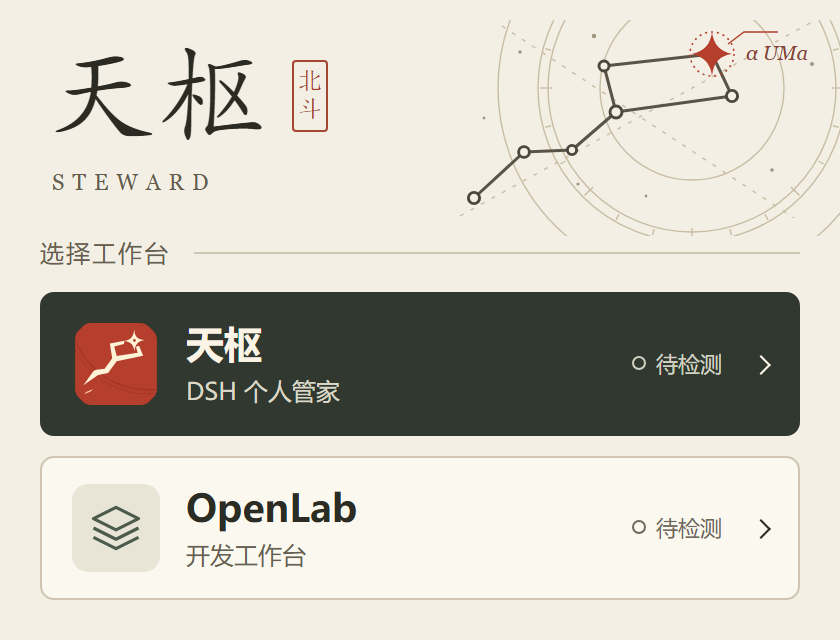

# 天枢 · 水墨版视觉交接

2026-11-25，用户确认采用水墨方案。交付范围为 Windows 桌面图标，以及打开天枢时选择 DSH 或 OpenLab 的首屏。设计资产已入库，基准提交为 `1ee8269`。桌面图标文件可直接使用；原生启动器仍显示旧布局，下一步是将下方设计接入现有 WinForms 窗口。

## 从哪里接手

| 需要做的事 | 使用文件 |
| --- | --- |
| 查看布局、悬停和键盘焦点 | 用本地浏览器打开[交互设计稿](butler/assets/tianshu-picker.html)，与两份 SVG 保持同目录即可离线预览。 |
| 对照首屏外观 | [首屏 PNG](butler/assets/tianshu-picker.png) 为 840 × 640，是内容区的两倍分辨率参考图。 |
| 设置快捷方式和窗口图标 | [Windows ICO](butler/assets/tianshu.ico) 含 16、20、24、32、48、64、128、256 像素八档；窗口内可用[透明背景 PNG](butler/assets/tianshu.png)。 |
| 调整图形 | [图标 SVG 母版](butler/assets/tianshu-seal.svg) 用于编辑墨斗；[远山北斗 SVG](butler/assets/tianshu-chart.svg) 是独立页首背景。 |
| 接入原生界面 | [启动器](butler/desktop/launcher.ps1) 已有两个点击动作和状态定时器。 |

## 定稿细节

北斗的斗柄画成一笔浓墨，斗口的天枢画成四芒星。主星在桌面图标和窗口右上星图中各出现一次。山影落在星图下方，向标题处渐淡。16–32 像素图标省去飞白和山影，并加粗斗形。后续导出图标应从水墨母版开始；现有 [make-icon.ps1](butler/desktop/make-icon.ps1) 仍会将同名 PNG 和 ICO 覆盖成旧图。

布局以 **420 × 320 的内容区**为准，系统标题栏另计。页首高 118，选择区两侧各留 20。两行入口各高 72，间距 10，行内图标为 44 × 44。底色用纸白 `#F7F7F4`，标题用浓墨 `#1D201E`，辅助文字用墨灰 `#5C605D`。标题字体依次回退到华文楷体、楷体、宋体，按钮文字用微软雅黑 UI。

## 原生接入

1. 现有脚本以 `Form.Size` 设置 420 × 320，包含窗口边框。按设计落地时改用 WinForms 的 `ClientSize` 设定内容区，并按系统 DPI 缩放。页首星图可从背景 SVG 按目标 DPI 渲染；两个入口保留独立控件，以支持键盘和状态更新。
2. 第一行显示「天枢 / DSH 个人管家」，浓墨底。点击整行调用现有 [open-tianshu.ps1](butler/desktop/open-tianshu.ps1)。第二行显示「OpenLab / 开发工作台」，纸白底。点击整行沿用现有 OpenLab 启动逻辑和程序缺失提示。
3. 每行右侧初始显示「待检测」。沿用现有 3 秒定时器，分别读取 DSH 的 3107 端口监听状态和 OpenLab 的进程状态，再显示「运行中」或「未启动」。HTML 中点击后的「已选择」仅演示交互反馈。

## 验收

设计稿已检查 320、360、420 像素宽的布局，已验证鼠标选择、Tab 和回车反馈，并核验了 ICO 的八档尺寸。以下项目留给原生接入后在 Windows 上验收。

- [ ] 快捷方式与窗口标题栏均显示水墨图标，小尺寸仍可辨认主星和斗柄。
- [ ] 在 100% 和 150% 显示缩放下，对照首屏 PNG 检查星图、行距、中文标签与右侧状态，文字完整可见。
- [ ] 鼠标点击和 Tab、回车均可打开对应工作台，Tab 顺序为天枢、OpenLab，键盘焦点可见。
- [ ] 状态按各自检测结果刷新。点击入口后仍能看到真实运行状态。
